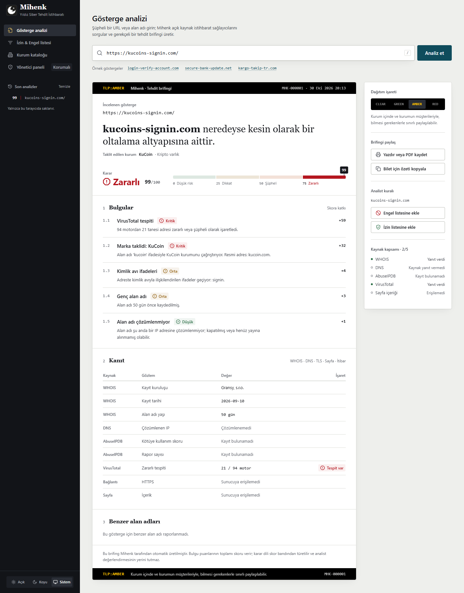
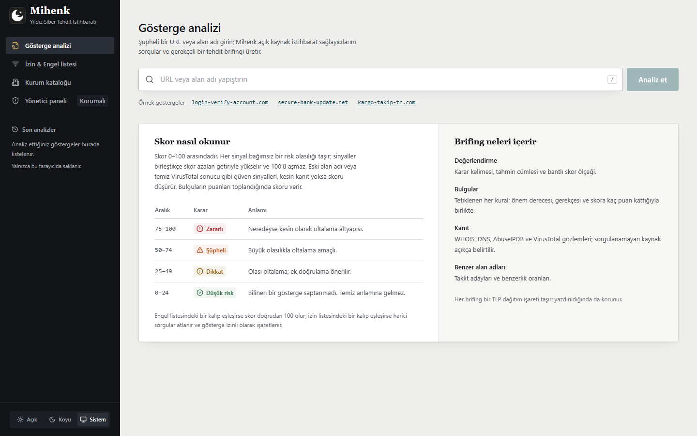
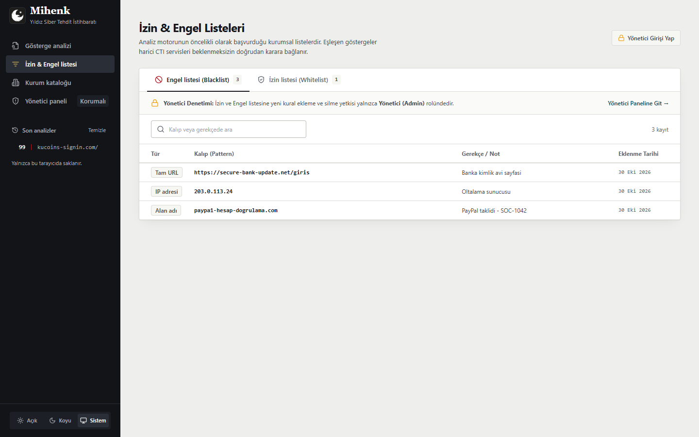
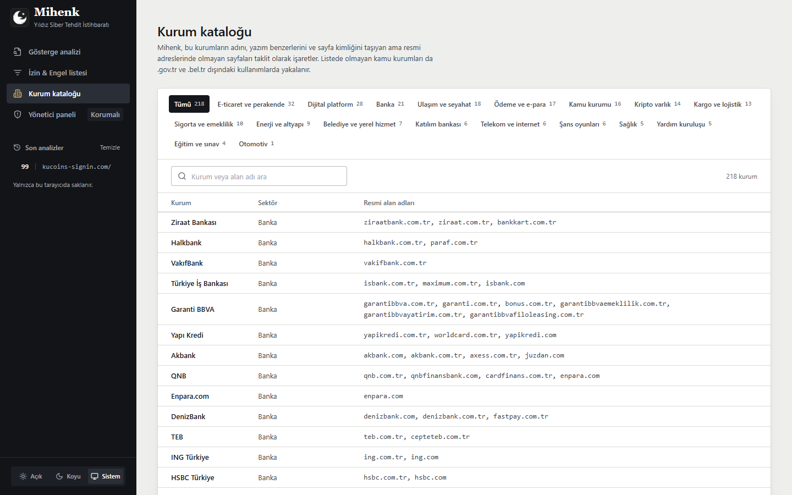
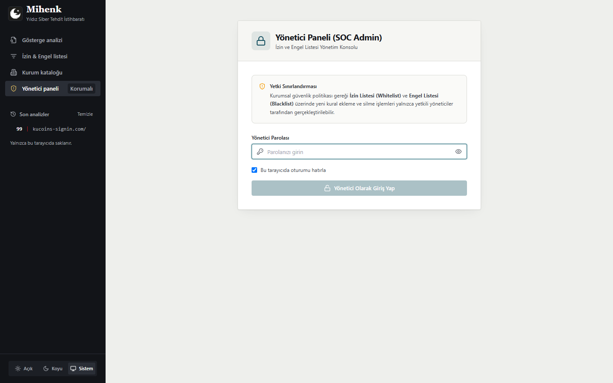
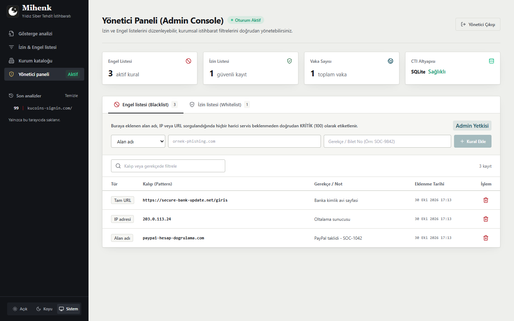
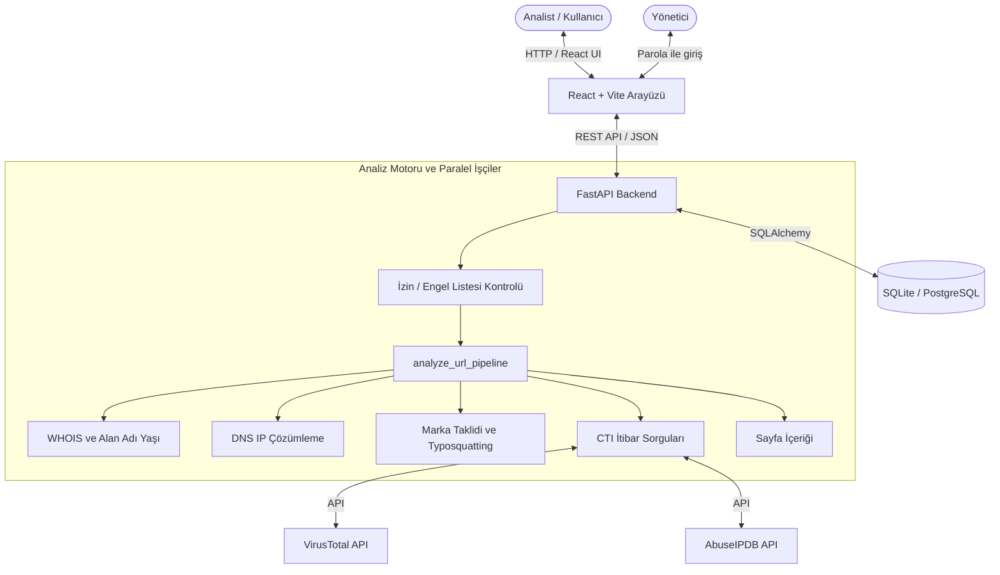

# Mihenk: Phishing Campaign Intelligence Platform


**Mihenk**, şüpheli URL ve alan adlarını (IOC - Indicator of Compromise) gerçek zamanlı olarak analiz eden, tehdit skorlaması yapan ve gerekçelendirilmiş siber tehdit istihbaratı (CTI) brifingleri üreten bir güvenlik platformudur.

---

## Ekran Görüntüleri

### Gösterge analizi: tehdit brifingi



> `https://kucoins-signin.com/` adresinin analizi: 99/100 skorla **Zararlı** kararı, KuCoin marka taklidi, VirusTotal tespiti, genç alan adı gibi bulgular, kaynak bazında kanıt tablosu ve TLP dağıtım işareti.

### Gösterge analizi: başlangıç ekranı



### İzin & Engel listesi



> Listeler herkes tarafından görüntülenebilir; kural ekleme ve silme yalnızca yönetici girişiyle yapılabilir.

### Kurum kataloğu



### Yönetici paneli

| Giriş | Yönetim konsolu |
| :---: | :---: |
|  |  |

---

## Öne Çıkan Özellikler

- **Açıklanabilir Tehdit Skoru (0 - 100):** WHOIS verileri, alan adı yaşı, TLD riskleri, şüpheli anahtar kelimeler ve itibar sorgularıyla hesaplanan skor. Her bulgu, skora kaç puan kattığıyla birlikte gösterilir. Kararlar: `Zararlı`, `Şüpheli`, `Dikkat`, `Düşük risk`.
- **Marka Taklidi ve Typosquatting Tespiti:** Banka, kripto borsa, e-ticaret, kamu kurumu gibi 218 kurumu içeren katalog üzerinden, kurum adını veya yazım benzerlerini taşıyan ama resmi adreste olmayan sayfaların tespiti.
- **İzin & Engel Listeleri:** Engel listesindeki bir kalıpla eşleşen gösterge harici sorgu beklenmeden Kritik (100) olarak değerlendirilir; izin listesindeki kalıplar harici sorgular atlanarak İzinli işaretlenir.
- **Yönetici Paneli:** Liste kurallarının eklenmesi ve silinmesi yalnızca yönetici girişiyle yapılabilir. Panel ayrıca kural ve analiz sayılarını gösterir.
- **Harici CTI Servis Entegrasyonları:**
  - **VirusTotal API:** Zararlı tespit analizleri.
  - **AbuseIPDB API:** IP adresi itibarı ve kötüye kullanım raporları.
  - **WHOIS ve DNS:** Kayıt tarihi, alan adı yaşı ve çözümlenen IP.
  - **Sayfa içeriği:** Şüpheli sayfa JavaScript çalıştırılmadan indirilip incelenir (`PAGE_FETCH_ENABLED`).
- **Eşzamanlı Analiz Hattı:** `ThreadPoolExecutor` ile WHOIS, DNS çözümleme ve itibar sorguları paralel yürütülür.
- **Paylaşılabilir Brifing:** TLP dağıtım işareti (CLEAR / GREEN / AMBER / RED), yazdırma ve PDF kaydetme, bilet için özet kopyalama.
- **Açık / Koyu / Sistem teması** ve tarayıcıda saklanan son analizler listesi.

---

## Teknoloji Yığını

| Katman | Teknoloji / Kütüphane | Açıklama |
| :--- | :--- | :--- |
| **Backend** | Python 3.11, FastAPI, Uvicorn | Yüksek performanslı REST API servisi |
| **Frontend** | React 18, Vite, TailwindCSS | Açık ve koyu temalı analist arayüzü |
| **Veritabanı** | SQLite / PostgreSQL | Geliştirmede hafif SQLite, Docker üzerinde PostgreSQL |
| **ORM ve Doğrulama** | SQLAlchemy 2.0, Pydantic v2 | Veritabanı modeli yönetimi ve şema doğrulamaları |
| **Kapsayıcı** | Docker ve Docker Compose | Multi-stage build ile optimize edilmiş konteynerizasyon |

---

## Sistem Mimarisi



---

## Kurulum ve Çalıştırma

Projeyi çalıştırmak için **iki farklı yöntem** bulunmaktadır.

### Yöntem 1: Docker Compose ile Çalıştırma (Önerilen)

Bilgisayarınızda [Docker Desktop](https://www.docker.com/products/docker-desktop/) kuruluysa tek komutla tüm servisleri ayağa kaldırabilirsiniz.

1. Proje dizinine gidin:
   ```bash
   cd Mihenk
   ```

2. `.env` dosyasını hazırlayın:
   ```bash
   cp .env.example .env
   ```

3. Konteynırları derleyin ve başlatın:
   ```bash
   docker-compose up --build
   ```

Servisler hazır olduğunda:
- **Frontend:** [http://localhost:5173](http://localhost:5173)
- **Backend ve Swagger API Dokümanı:** [http://localhost:8000/docs](http://localhost:8000/docs)

---

### Yöntem 2: Yerel Ortamda Manuel Çalıştırma (Python + Node.js)

#### 1. Backend (FastAPI)

```bash
# 1. Proje klasörüne gidin
cd Mihenk

# 2. .env dosyasını oluşturun
cp .env.example .env

# 3. Python sanal ortamı oluşturun ve aktif edin
python -m venv venv
# Windows için:
.\venv\Scripts\activate
# Linux/macOS için:
source venv/bin/activate

# 4. Bağımlılıkları yükleyin
pip install -r backend/requirements.txt

# 5. FastAPI sunucusunu başlatın
python -m uvicorn backend.main:app --reload --port 8000
```

#### 2. Frontend (React + Vite)

Yeni bir terminal penceresinde:

```bash
# 1. Proje klasörüne gidin
cd Mihenk

# 2. NPM paketlerini yükleyin
npm install

# 3. Geliştirme sunucusunu başlatın
npm run dev
```

#### Testler

```bash
python -m pytest backend/tests -q
```

---

## Ortam Değişkenleri (.env)

Projenin kök dizininde yer alan `.env` dosyası konfigürasyon parametrelerini barındırır:

```env
# Veritabanı Bağlantısı (SQLite veya PostgreSQL)
DATABASE_URL=sqlite:///./cti_platform.db

# Harici CTI API Anahtarları (İsteğe bağlı - Ücretsiz hesaplardan temin edilebilir)
VIRUSTOTAL_API_KEY=your_virustotal_api_key_here
ABUSEIPDB_API_KEY=your_abuseipdb_api_key_here

# Sunucu Portu
PORT=8000

# Sayfa içeriği analizi (şüpheli sayfa JavaScript çalıştırılmadan indirilir). Kapatmak için false yapın.
PAGE_FETCH_ENABLED=true

# Yönetici paneli giriş parolası (mutlaka değiştirin)
ADMIN_PASSWORD=change_me
```

---

## API Uç Noktaları (Endpoints)

| Yöntem | Endpoint | Açıklama |
| :--- | :--- | :--- |
| `POST` | `/analyze/url` | Verilen URL için tam CTI analizi ve risk skorlaması yapar |
| `GET` | `/ioc/{ioc_id}` | Tek bir IOC kaydını ve son analiz sonucunu getirir |
| `GET` | `/ioc/{ioc_id}/related` | IOC ile ilişkili benzer alan adlarını listeler |
| `GET` | `/campaign/{campaign_id}` | Kampanya detaylarını ve ilişkili IOC listesini döner |
| `GET` | `/brands` | Taklit tespitinde kullanılan kurum kataloğunu döner |
| `GET` | `/lists` | İzin ve engel listesi kurallarını listeler (`?list_type=whitelist\|blacklist`) |
| `POST` | `/lists` | Yeni kural ekler (yalnızca yönetici) |
| `DELETE` | `/lists/{item_id}` | Kuralı siler (yalnızca yönetici) |
| `POST` | `/admin/login` | Yönetici girişi |
| `GET` | `/admin/verify` | Yönetici oturumunu doğrular |
| `GET` | `/admin/stats` | Platform istatistiklerini döner |
| `GET` | `/health` | Servis sağlık durumunu kontrol eder |

Yönetici gerektiren isteklerde oturum anahtarı `X-Admin-Token` başlığıyla gönderilir. Etkileşimli Swagger dokümantasyonu için sunucu çalışırken `http://localhost:8000/docs` adresini ziyaret edebilirsiniz.

---

## Proje Dizin Yapısı

```
Phishing-Campaign-Intelligence-Platform/
├── backend/                  # FastAPI arka plan servisleri
│   ├── api/                  # API rotaları (analyze, ioc, campaign, lists, brands, admin)
│   ├── core/                 # Analiz motoru (WHOIS, typosquat, itibar, skorlama, sayfa içeriği)
│   ├── data/                 # Kurum kataloğu (tr_brands.json)
│   ├── models/               # SQLAlchemy veritabanı modelleri ve bağlantı
│   ├── schemas/              # Pydantic veri doğrulama şemaları
│   ├── tests/                # Backend testleri
│   ├── config.py             # Ayarlar ve ortam değişkenleri
│   └── main.py               # FastAPI uygulama giriş noktası
├── src/                      # React frontend uygulaması
│   ├── api/                  # Backend API istemcisi
│   ├── components/           # Arayüz bileşenleri (brief, layout, ui)
│   ├── lib/                  # Yardımcılar (tema, yönlendirme, TLP, karar)
│   ├── pages/                # Sayfalar (Analiz, Kurallar, Katalog, Yönetici)
│   ├── App.jsx               # Ana uygulama
│   └── index.css             # TailwindCSS stilleri
├── docs/
│   └── screenshots/          # README ekran görüntüleri
├── .env.example              # Örnek ortam değişkenleri dosyası
├── Dockerfile                # Frontend Docker yapılandırması
├── docker-compose.yml        # Çoklu konteyner (DB + Backend + Frontend)
├── package.json              # Node.js bağımlılıkları ve komutları
└── README.md                 # Proje dokümantasyonu
```

---

## Lisans

Bu proje MIT Lisansı altında lisanslanmıştır. Güvenlik araştırmaları ve eğitim amaçlı kullanıma uygundur.
